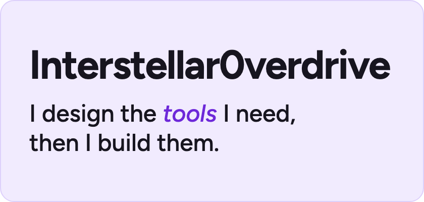
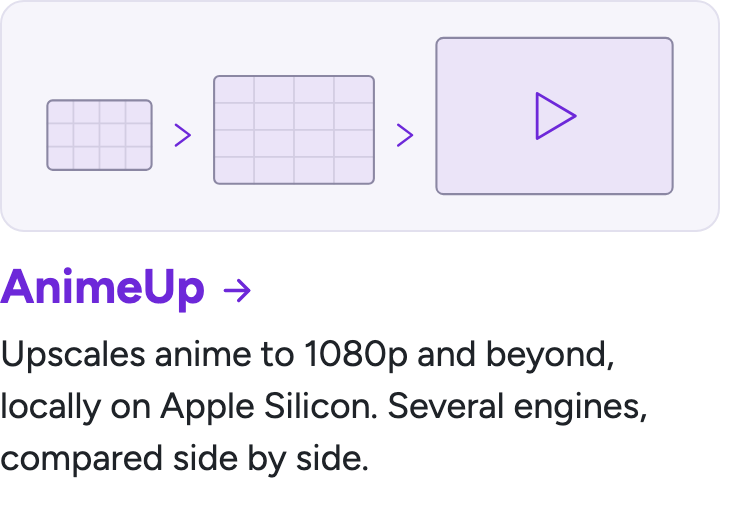
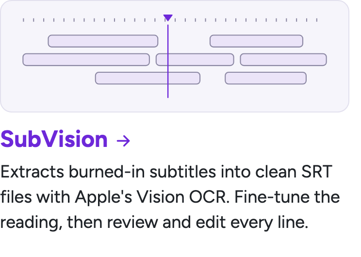
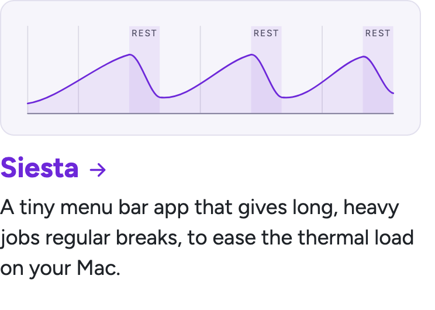

<picture><source media="(prefers-color-scheme: dark) and (min-width: 1012px), (prefers-color-scheme: dark) and (min-width: 640px) and (max-width: 767px)" srcset="assets/head-wide-dark.png"><source media="(prefers-color-scheme: dark)" srcset="assets/head-narrow-dark.png"><source media="(min-width: 1012px), (min-width: 640px) and (max-width: 767px)" srcset="assets/head-wide-light.png"></picture>

Hi, I'm Alberto, Creative Director in Milan. I've been designing for twenty years, from industrial design and packaging to brands, intranets and apps; today I lead a team of about 30 designers in Experience Design and User-Centered Design.

When a tool I need doesn't exist, I design it, because design is what I do best. I started out writing HTML, CSS and even Flash, but I'm no developer: AI turns my designs into working apps, while I stay in the lead and test everything extensively before it ships.

Outside work, my home is my lab: it runs on Home Assistant, from the BTicino system to a hydroponic greenhouse and the NAS.

## Mac apps

<!-- One picture per app: from 1300 px it shows the desktop card, below it the stacked card. 2x keeps them at their natural size, so the three desktop cards fill the 846 px README exactly. -->

<a href="https://github.com/Interstellar0verdrive/AnimeUp"><picture><source media="(prefers-color-scheme: dark) and (min-width: 1300px)" srcset="assets/desk-animeup-dark.png 2x"><source media="(prefers-color-scheme: dark)" srcset="assets/item-animeup-dark.png 2x"><source media="(min-width: 1300px)" srcset="assets/desk-animeup-light.png 2x"><source srcset="assets/item-animeup-light.png 2x"></picture></a><a href="https://github.com/Interstellar0verdrive/SubVision"><picture><source media="(prefers-color-scheme: dark) and (min-width: 1300px)" srcset="assets/desk-subvision-dark.png 2x"><source media="(prefers-color-scheme: dark)" srcset="assets/item-subvision-dark.png 2x"><source media="(min-width: 1300px)" srcset="assets/desk-subvision-light.png 2x"><source srcset="assets/item-subvision-light.png 2x"></picture></a><a href="https://github.com/Interstellar0verdrive/Siesta"><picture><source media="(prefers-color-scheme: dark) and (min-width: 1300px)" srcset="assets/desk-siesta-dark.png 2x"><source media="(prefers-color-scheme: dark)" srcset="assets/item-siesta-dark.png 2x"><source media="(min-width: 1300px)" srcset="assets/desk-siesta-light.png 2x"><source srcset="assets/item-siesta-light.png 2x"></picture></a>

## Smart home

<a href="https://github.com/OpenWebNet-HA/MyHOME"><picture><source media="(prefers-color-scheme: dark)" srcset="assets/link-myhome-dark.png"></picture></a> <a href="https://github.com/OpenWebNet-HA/MyHOME/stargazers"><picture><source media="(prefers-color-scheme: dark)" srcset="https://img.shields.io/github/stars/OpenWebNet-HA/MyHOME?style=flat&label=%E2%98%85%20stars&labelColor=2e2a45&color=6d4fd8"></picture></a>
 
I'm one of the maintainers of this Home Assistant integration for BTicino and Legrand MyHOME systems.

<a href="https://github.com/Interstellar0verdrive/Linfa-local-control"><picture><source media="(prefers-color-scheme: dark)" srcset="assets/link-linfa-local-control-dark.png"></picture></a>
 
A local bridge that brings Robonica Linfa hydroponic greenhouses into Home Assistant, over MQTT.

<a href="https://github.com/Interstellar0verdrive/ugreen-telemetry-mqtt"><picture><source media="(prefers-color-scheme: dark)" srcset="assets/link-ugreen-dark.png"></picture></a>
 
UGREEN NAS telemetry over MQTT, with a setup wizard in the browser. Ready for Home Assistant.

### From the archive

<a href="https://github.com/Interstellar0verdrive/frontail_AEM"><picture><source media="(prefers-color-scheme: dark)" srcset="assets/link-frontail-dark.png"></picture></a>
 
My fork of Frontail, the log viewer in the browser, made for openHAB: highlighting rules with regular expressions and a light and dark theme in the same page. Since openHABian 1.6.4 it's the Frontail it installs.

 

<a href="https://www.linkedin.com/in/albertoangeli/"><picture><source media="(prefers-color-scheme: dark)" srcset="assets/chip-linkedin-dark.png"></picture></a> <a href="https://ko-fi.com/Interstellar0verdrive"><picture><source media="(prefers-color-scheme: dark)" srcset="assets/chip-kofi-dark.png"></picture></a>

