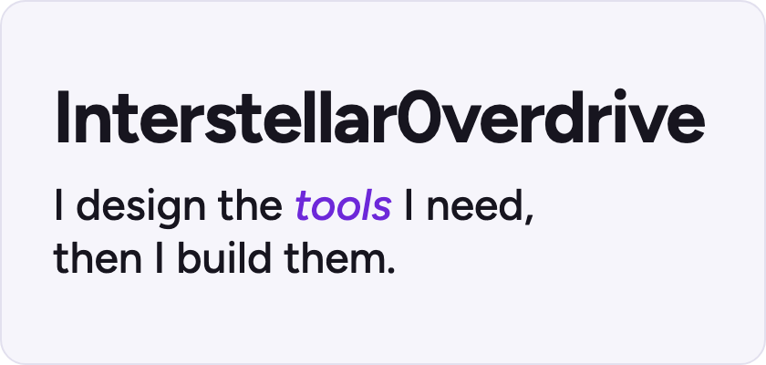
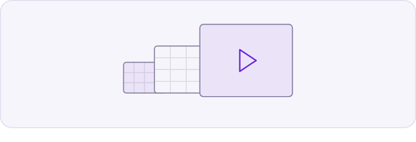
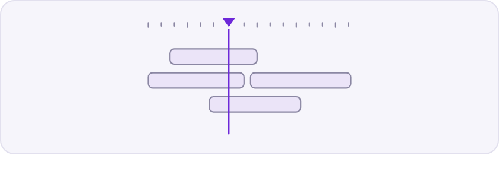
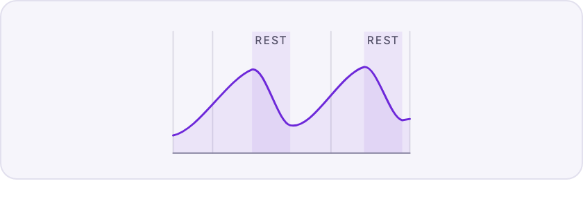
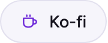

<picture><source media="(prefers-color-scheme: dark) and (min-width: 1012px), (prefers-color-scheme: dark) and (min-width: 640px) and (max-width: 767px)" srcset="assets/header-dark.png"><source media="(prefers-color-scheme: dark)" srcset="assets/header-narrow-dark.png"><source media="(min-width: 1012px), (min-width: 640px) and (max-width: 767px)" srcset="assets/header-light.png"></picture>

Hi, I'm Alberto, Creative Director in Milan. I've been designing for twenty years, from industrial design and packaging to brands, intranets and apps; today I lead a team of about 30 designers in Experience Design and User-Centered Design.

When a tool I need doesn't exist, I design it, because design is what I do best. I started out writing HTML, CSS and even Flash, but I'm no developer: AI turns my designs into working apps, while I stay in the lead and test everything extensively before it ships.

Outside work, my home is my lab: it runs on Home Assistant, from the BTicino system to a hydroponic greenhouse and the NAS.

## Mac apps

<a href="https://github.com/Interstellar0verdrive/AnimeUp"><picture><source media="(prefers-color-scheme: dark)" srcset="assets/app-animeup-dark.png"></picture></a><a href="https://github.com/Interstellar0verdrive/AnimeUp"><picture><source media="(prefers-color-scheme: dark)" srcset="assets/title-animeup-dark.png"></picture></a>
 
Upscales anime to 1080p and beyond, locally on Apple Silicon. Several engines, compared side by side.
 

<a href="https://github.com/Interstellar0verdrive/SubVision"><picture><source media="(prefers-color-scheme: dark)" srcset="assets/app-subvision-dark.png"></picture></a><a href="https://github.com/Interstellar0verdrive/SubVision"><picture><source media="(prefers-color-scheme: dark)" srcset="assets/title-subvision-dark.png"></picture></a>
 
Extracts burned-in subtitles into clean SRT files with Apple's Vision OCR, offline. Fine-tune the reading, then review and edit every line.
 

<a href="https://github.com/Interstellar0verdrive/Siesta"><picture><source media="(prefers-color-scheme: dark)" srcset="assets/app-siesta-dark.png"></picture></a><a href="https://github.com/Interstellar0verdrive/Siesta"><picture><source media="(prefers-color-scheme: dark)" srcset="assets/title-siesta-dark.png"></picture></a>
 
A tiny menu bar app that gives long, heavy jobs regular breaks, to ease the thermal load on your Mac.
 

## Smart home

<a href="https://github.com/OpenWebNet-HA/MyHOME"><picture><source media="(prefers-color-scheme: dark)" srcset="assets/name-myhome-dark.png"></picture></a> <a href="https://github.com/OpenWebNet-HA/MyHOME/stargazers"><picture><source media="(prefers-color-scheme: dark)" srcset="https://img.shields.io/github/stars/OpenWebNet-HA/MyHOME?style=flat&label=%E2%98%85%20stars&labelColor=2e2a45&color=6d4fd8"></picture></a>
 
I'm one of the maintainers of this Home Assistant integration for BTicino and Legrand MyHOME systems.

<a href="https://github.com/Interstellar0verdrive/Linfa-local-control"><picture><source media="(prefers-color-scheme: dark)" srcset="assets/name-linfa-dark.png"></picture></a>
 
A local bridge that brings Robonica Linfa hydroponic greenhouses into Home Assistant, over MQTT.

<a href="https://github.com/Interstellar0verdrive/ugreen-telemetry-mqtt"><picture><source media="(prefers-color-scheme: dark)" srcset="assets/name-ugreen-dark.png"></picture></a>
 
UGREEN NAS telemetry over MQTT, with a setup wizard in the browser. Ready for Home Assistant.

### From the archive

<a href="https://github.com/Interstellar0verdrive/frontail_AEM"><picture><source media="(prefers-color-scheme: dark)" srcset="assets/name-frontail-dark.png"></picture></a>
 
My fork of Frontail, the log viewer in the browser, made for openHAB: highlighting rules with regular expressions and a light and dark theme in the same page. Since openHABian 1.6.4 it's the Frontail it installs.

 

<a href="https://www.linkedin.com/in/albertoangeli/"><picture><source media="(prefers-color-scheme: dark)" srcset="assets/chip-linkedin-dark.png"></picture></a> <a href="https://ko-fi.com/Interstellar0verdrive"><picture><source media="(prefers-color-scheme: dark)" srcset="assets/chip-kofi-dark.png"></picture></a>

